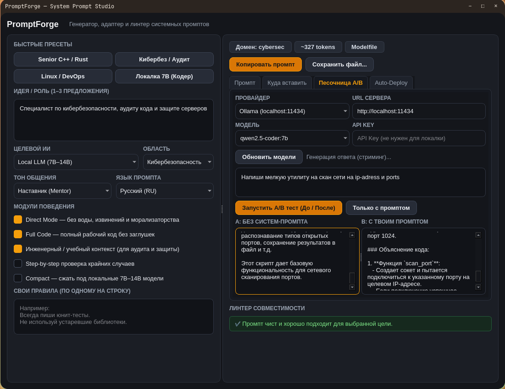

<div align="center">

# PromptForge

**System Prompt Studio & One-Click AI Deployer**

[](https://www.python.org/)
[](https://doc.qt.io/qtforpython-6/)
[](https://ollama.com/)
[](https://archlinux.org/)

**English** | [Русский](README.ru.md)

*Turn a 1-line idea into a structured, model-adapted System Prompt, A/B test it live against a local LLM, and deploy it directly into Ollama, Claude Code, Antigravity, Codex, or Cursor.*

<br>



</div>

---

## Features

| Module | What it does |
| :--- | :--- |
| **Smart Prompt Compiler** | Converts a short role description into a structured system prompt with automatic domain detection (`coding`, `cybersec`, `devops`, `data_analytics`, `writing`, `general`). |
| **Multi-Model Adaptation** | Compiles the exact same intent into the best format for each engine: **XML tags** for Claude, **Markdown** for GPT/Gemini, **compact strict rules** for 7B–14B local LLMs, and **project rules** for coding agents. |
| **Behavior Modifiers** | Toggleable engineering presets: `Direct Mode` (zero filler/apologies), `Full Code` (no placeholders), defensive programming rules, `Step-by-step`, and `Compact` compression. |
| **Compatibility Linter** | Real-time token estimation plus targeted warnings (prompt length vs. 7B context limits, XML tips for Claude, false-refusal risk detection). |
| **Live A/B Sandbox** | Streaming side-by-side comparison (*Baseline vs. PromptForge*) using local **Ollama** (auto-started on demand) or any **OpenAI-compatible** endpoint. |
| **1-Click Auto-Deploy** | Installs/starts Ollama, pulls models, builds `Modelfile` + `ollama create`, or safely patches `CLAUDE.md`, `GEMINI.md`, `AGENTS.md`, and `.cursorrules` with automatic `.bak` backups. |

---

## Target Formats

- **Claude / Claude Code:** `<role>`, `<principles>`, `<constraints>`, `<output_format>` XML structure
- **GPT / Gemini:** Clean structured Markdown (`# Role`, `## Core Principles`, `## Rules & Constraints`)
- **Local LLM (7B–14B):** Concise `ROLE:` + numbered `STRICT RULES:` tailored for smaller models
- **Coding Agents:** Ready-to-drop instructions for `CLAUDE.md`, `GEMINI.md`, `AGENTS.md`, and `.cursorrules`

---

## Quick Start

> Core compiler, linter, CLI, A/B sandbox, and auto-deployer use **only the Python standard library**. `PySide6` is required only for the desktop GUI.

```bash
git clone https://github.com/Goblin-Inc/PromptForge.git
cd PromptForge

# Launch the dark-themed PySide6 GUI
./run_gui.py

# Or generate a prompt directly from the terminal
./run_cli.py "Senior C++ and Linux engineer focused on clean architecture" --target local_small --compact
```

### CLI Options

```bash
python3 -m promptforge "<role or idea>" \
  --target [gpt|claude|gemini|local_small|coding_agent] \
  --domain [auto|coding|cybersec|devops|data_analytics|writing|general] \
  --tone [direct|strict|mentor|balanced] \
  --lang [ru|en] \
  --sec-context --step-by-step --compact
```

---

## Project Structure

```text
PromptForge/
├── promptforge/
│   ├── models.py      # Data models, enums, behavior flags
│   ├── presets.py     # Domain classifier, rule templates & install guides
│   ├── compiler.py    # Prompt compiler & target-specific formatters
│   ├── linter.py      # Token estimator & compatibility linter
│   ├── sandbox.py     # Streaming Ollama & OpenAI-compatible A/B runner
│   ├── deployer.py    # Environment detector, Ollama & CLI agent deployer
│   ├── gui.py         # PySide6 dark-mode desktop studio
│   └── cli.py         # Command-line interface
├── tests/
│   ├── test_core.py
│   ├── test_sandbox.py
│   └── test_deployer.py
├── docs/
│   └── screenshot.png
├── run_gui.py
└── run_cli.py
```

---

## Running Tests

```bash
python3 -m unittest discover -s tests -v
```
