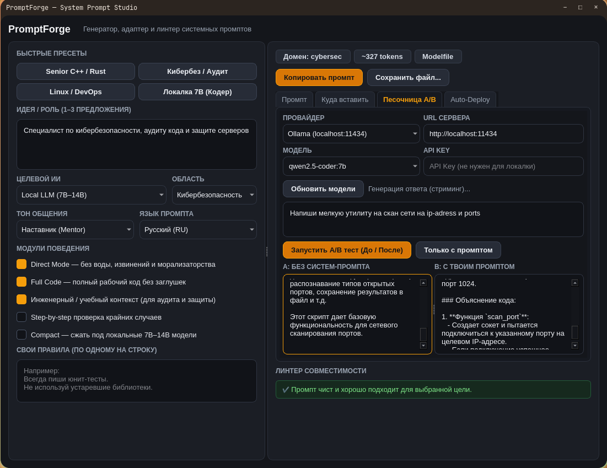

<div align="center">

# PromptForge

**Студия системных промптов и авто-деплоя в ИИ в 1 клик**

[](https://www.python.org/)
[](https://doc.qt.io/qtforpython-6/)
[](https://ollama.com/)
[](https://archlinux.org/)

[English](README.md) | **Русский**

*Превращает короткую идею в структурированный System Prompt под нужную нейросеть, тестирует его вживую через A/B песочницу и автоматически устанавливает в Ollama, Claude Code, Antigravity, Codex или Cursor.*

<br>



</div>

---

## Возможности

| Модуль | Что делает |
| :--- | :--- |
| **Умный компилятор** | Разворачивает 1–2 фразы в полноценный системный промпт с автоопределением области (`coding`, `cybersec`, `devops`, `data_analytics`, `writing`, `general`). |
| **Адаптация под движок** | Пересобирает одну и ту же роль в оптимальный формат: **XML-теги** для Claude, **Markdown** для GPT/Gemini, **жёсткие директивы** для локальных 7B–14B моделей и **правила проекта** для coding-агентов. |
| **Модули поведения** | Переключатели `Direct Mode` (без воды и вводных фраз), `Full Code` (без заглушек), практики защитного программирования, `Step-by-step` и сжатие `Compact`. |
| **Линтер совместимости** | Подсчёт токенов в реальном времени и подсказки: предупреждения о длине для 7B, советы по формату и обнаружение фраз, вызывающих ложные отказы. |
| **Песочница A/B (стриминг)** | Живое сравнение ответов (*Без промпта vs С твоим промптом*) через локальную **Ollama** (с авто-запуском сервера) или любой **OpenAI-compatible** API. |
| **Auto-Deploy в 1 клик** | Установка/запуск Ollama, скачивание моделей (`ollama pull`), сборка `Modelfile` + `ollama create`, либо безопасная запись в `CLAUDE.md`, `GEMINI.md`, `AGENTS.md` и `.cursorrules` с авто-бэкапом `*.bak.*`. |

---

## Поддерживаемые форматы

- **Claude / Claude Code:** XML-блоки `<role>`, `<principles>`, `<constraints>`, `<output_format>`
- **GPT / Gemini:** структурированный Markdown (`# Role`, `## Core Principles`, `## Rules & Constraints`)
- **Local LLM (7B–14B):** компактный список `ROLE:` + нумерованные `STRICT RULES:`
- **Coding Agents:** готовые инструкции для `CLAUDE.md`, `GEMINI.md`, `AGENTS.md` и `.cursorrules`

---

## Быстрый старт

> Ядро генератора, линтер, CLI, песочница и deployer работают **на чистой стандартной библиотеке Python**. `PySide6` нужен только для графического интерфейса.

```bash
git clone https://github.com/Goblin-Inc/PromptForge.git
cd PromptForge

# Запуск тёмного GUI на PySide6
./run_gui.py

# Или генерация прямо из терминала
./run_cli.py "Опытный программист C++ и Linux" --target local_small --compact
```

### Флаги CLI

```bash
python3 -m promptforge "<роль или идея>" \
  --target [gpt|claude|gemini|local_small|coding_agent] \
  --domain [auto|coding|cybersec|devops|data_analytics|writing|general] \
  --tone [direct|strict|mentor|balanced] \
  --lang [ru|en] \
  --sec-context --step-by-step --compact
```

---

## Структура проекта

```text
PromptForge/
├── promptforge/
│   ├── models.py      # Модели данных, перечисления и флаги поведения
│   ├── presets.py     # Классификатор доменов, шаблоны правил и гайды
│   ├── compiler.py    # Компилятор и форматтеры под целевые ИИ
│   ├── linter.py      # Оценка токенов и линтер совместимости
│   ├── sandbox.py     # Стриминг-клиент Ollama / OpenAI-compatible и A/B тест
│   ├── deployer.py    # Проверка среды, Ollama и авто-деплой в CLI-агентов
│   ├── gui.py         # Десктопный интерфейс на PySide6
│   └── cli.py         # Интерфейс командной строки
├── tests/
│   ├── test_core.py
│   ├── test_sandbox.py
│   └── test_deployer.py
├── docs/
│   └── screenshot.png
├── run_gui.py
└── run_cli.py
```

---

## Тесты

```bash
python3 -m unittest discover -s tests -v
```
